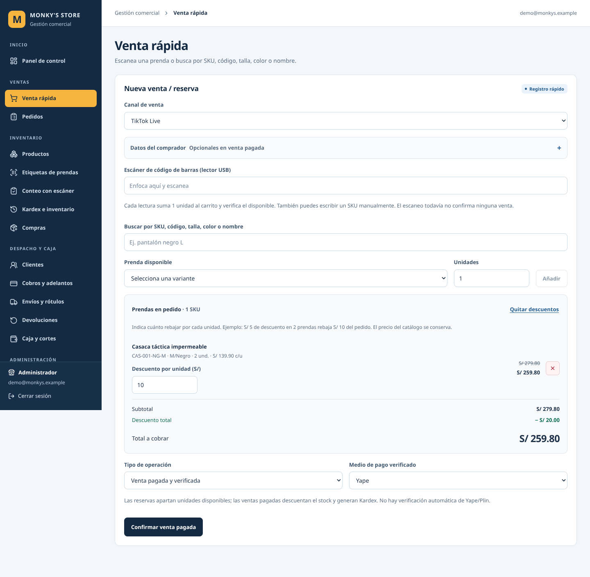
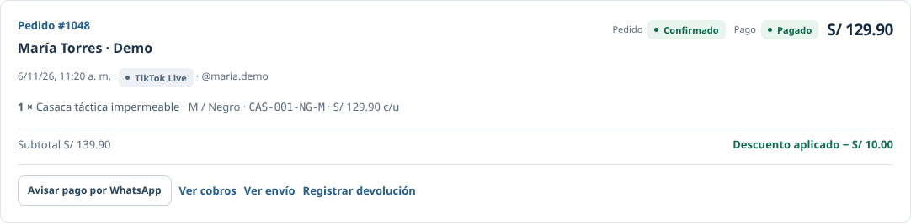

# Descuentos en Venta rápida

## Activación en Supabase

El código de la aplicación y el SQL están preparados. La ejecución en la cuenta real de Supabase queda pendiente: no se dispone de una conexión administrativa a esa base desde este entorno.

1. En el proyecto de Supabase usado por el ERP, abre **SQL Editor → New query**.
2. Copia el contenido completo de [010_descuentos_venta.sql](supabase/migrations/010_descuentos_venta.sql) y ejecuta **Run**. Esta migración requiere que ya esté aplicada la 009.
3. Actualiza Venta rápida y registra una operación de prueba autorizada para comprobarla con tu sesión.

La migración añade una columna opcional a las líneas del pedido para conservar el precio original, actualiza la creación transaccional del pedido y publica una entrada RPC para los descuentos. No elimina ni recalcula pedidos anteriores, no cambia precios del catálogo y no amplía permisos. La prueba de actualización con datos existentes, incluida una segunda ejecución, conservó pedidos, líneas, pagos y existencias.

Antes de aplicar 010, las operaciones sin descuento siguen usando la función existente. Una operación con descuento se detiene con una explicación: **no se reintenta al precio completo**.

## Cómo usarlo

1. Añade prendas al carrito mediante búsqueda o escáner.
2. Pulsa **Añadir descuentos**.
3. Escribe el **descuento por unidad en soles** en las prendas que correspondan. Puedes dejar las demás sin descuento.
4. Comprueba subtotal, descuento total y total a cobrar o reservar.
5. Confirma la operación como hasta ahora. **Quitar descuentos** restaura el importe sin borrar las prendas.

Ejemplo: 2 prendas de S/ 100 y un descuento de S/ 10 por unidad dan un subtotal de S/ 200, un descuento total de S/ 20 y un total de S/ 180.

Los campos adicionales se muestran solo al solicitarlos. El descuento admite dos decimales, debe ser cero o mayor y debe dejar un precio final positivo cuando se rebaja una prenda. Esta entrega utiliza importes por unidad, sin porcentajes ni promociones automáticas.

## Integridad de los importes

- PostgreSQL obtiene el precio del catálogo y valida el descuento dentro de la misma transacción que crea el pedido y mueve o reserva existencias.
- Se guarda el precio original en `order_lines.catalog_unit_price` y el precio acordado en `unit_price`. `line_total`, `orders.total` y el cobro utilizan el importe rebajado.
- Cobros, adelantos, devoluciones y reportes ya usan esos importes guardados. No se añadió una rebaja visual separada del importe real.
- El registro de auditoría conserva el descuento total y el usuario que creó la operación. En Pedidos se muestra el descuento guardado y el precio final por unidad; las líneas históricas sin ese dato no se presentan como rebajadas.
- Si el precio del catálogo cambió después de añadir la prenda, la base rechaza la operación para que se vuelva a consultar el precio antes de confirmar.
- Los reintentos conservan la clave de operación. La misma venta no vuelve a descontar stock ni a registrar un cobro; cambiar el descuento de una operación ya guardada se rechaza.
- Los cálculos de vista previa usan céntimos para evitar errores de coma flotante. Los importes se recalculan y validan en la base.

## Archivos de implementación

| Archivo | Cambio |
| --- | --- |
| `components/sale-form.tsx` | Edición opcional de descuentos, resumen y conservación de datos al fallar. |
| `lib/sale-totals.ts` | Vista previa monetaria en céntimos y validación de importes. |
| `lib/actions.ts` | Validación del servidor y RPC explícita para descuentos. |
| `supabase/migrations/010_descuentos_venta.sql` | Precio original, cálculo transaccional, auditoría y compatibilidad. |
| `app/(sistema)/pedidos/page.tsx`, `lib/types.ts` | Lectura del descuento guardado y precio acordado. La relación usa `*` para funcionar también antes de que exista la nueva columna; los costes no se renderizan. |
| `app/globals.css` | Distribución del descuento en computadora y celular. |
| `tests/erp-discounts.test.mjs`, `tests/erp-actions.test.mjs`, `tests/erp-pages.test.mjs` | Regresiones de SQL, servidor, interfaz y presentación del pedido. |

## Verificación realizada

| Comprobación | Resultado |
| --- | --- |
| `npm run typecheck` | Correcto. |
| `npm run build` | Compilación de producción correcta con variables de conexión ficticias. |
| `npm run test:regression` | 47 correctas, 0 fallidas; incluye 13 nuevas comprobaciones de descuentos. |
| Controles estáticos de fases 2, 3, 4A, 4B y despliegue | Correctos. |
| SQL en PGlite con las migraciones reales | Precio original y neto, cobro, stock, mezcla de prendas, reportes, adelantos, devolución, decimales, importes inválidos, precio obsoleto, reintentos, permisos y migración repetible con datos existentes. |
| Navegador con páginas reales y respuestas de Supabase simuladas | 9 comprobaciones correctas: apertura opcional, nuevo escaneo, límites, decimales, quitar descuentos, falta de migración, error, éxito y lectura del pedido. |
| Adaptación | Sin desbordamiento horizontal del documento a 1440, 834, 390 y 320 px. |
| axe, etiquetas WCAG 2 A/AA y 2.1 AA | 0 infracciones detectadas en esos cuatro tamaños. No equivale a una certificación. |
| Errores JavaScript durante el recorrido | Ninguno. |

[Resultados del navegador](docs/descuentos/verificaciones.json).

La autenticación del motor SQL se simuló mediante los roles de prueba; se ejecutaron las funciones, restricciones y permisos reales de las migraciones. PGlite utiliza una conexión y no sustituye una prueba de concurrencia con varias conexiones en Supabase. El bloqueo transaccional y de filas se conservó. Las capturas del navegador utilizan datos ficticios y no modificaron la cuenta de producción. Las sustituciones para las pruebas solo existieron en una copia temporal y no forman parte de la aplicación entregada.

## Capturas de prueba

[Ver adaptación a celular](docs/descuentos/venta-celular.png).

Queda pendiente aplicar 010 y comprobar una venta y una reserva con la sesión real de Supabase. La comprobación de pedidos existentes con pruebas locales fue correcta; no se inspeccionaron datos personales de producción.
