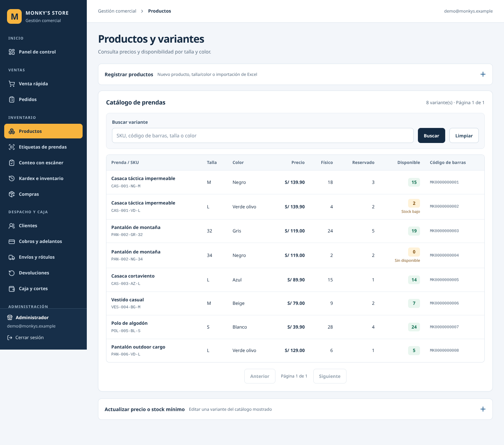
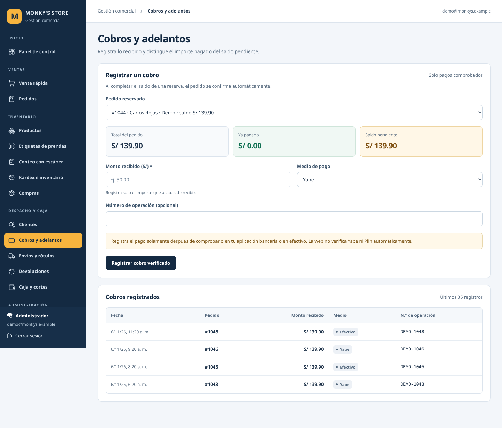
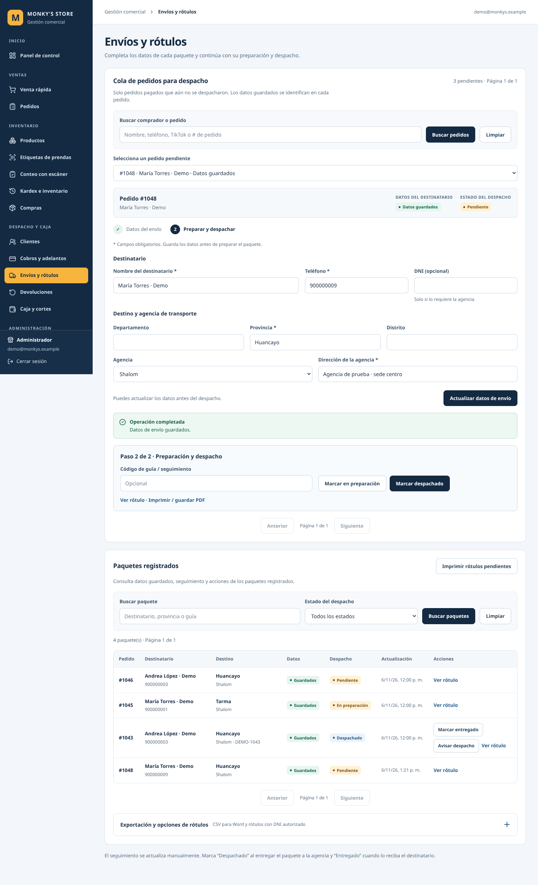

# Monky’s Store — revisión e implementación de UI/UX

Fecha: 6 de noviembre de 2026. Base revisada: `main` en `48d6d798b8baf77762f7f7382ef6b6971b4f6a17`.

## Alcance y método

Se revisaron la navegación, los estilos y los componentes existentes. El proyecto utiliza Next.js con App Router, React, TypeScript, Supabase, Zod y Lucide. Se conservaron estas tecnologías, las acciones del servidor, los permisos, las consultas que determinan los registros elegibles y las reglas de stock, pagos y despacho.

La comprobación visual e interactiva se hizo ejecutando las páginas y los componentes reales en una copia temporal con autenticación y respuestas de Supabase simuladas. Todos los nombres, teléfonos, pedidos e importes de las capturas son ficticios. La sustitución de autenticación solo existió en esa copia temporal y no forma parte de los cambios entregados.

Se recorrieron Productos, Kardex e inventario, Pedidos, Cobros, Envíos y Venta rápida. Las conclusiones sobre presentación e interacción corresponden a esa ejecución controlada; no equivalen a una sesión autenticada contra la base de producción.

## Hallazgos y cambios

| Pantalla o componente | Hallazgo y evidencia | Cambio aplicado |
| --- | --- | --- |
| Productos | Observado: los formularios administrativos desplazaban la búsqueda y el catálogo por debajo de la primera pantalla. | Registro e importación en un bloque desplegable; precio y stock mínimo en otro. Búsqueda y primeras filas visibles al entrar. |
| Navegación y estilos compartidos | Observado: controles, encabezados y márgenes grandes reducían la información útil visible. Revisado en código: el menú móvil no contenía ni restauraba el foco. | Barra lateral de 248 px, encabezados compactos, navegación activa y contexto de módulo. Menú móvil con Escape, foco contenido y restaurado al botón de apertura. |
| Envíos en tablet | Observado en la versión anterior: desbordamiento horizontal de la página a 834 px. | Columnas flexibles, campos con ancho mínimo adecuado y tablas con desplazamiento dentro de su contenedor. La página completa ya no desborda en los anchos probados. |
| Envíos | Observado: los datos guardados y el estado del despacho compartían un aviso, dificultando distinguir qué se había completado. | Indicadores separados: «Datos guardados / Sin guardar / Cambios sin guardar» y estado real del despacho. Sin registro se informa «Sin envío registrado». No se inventó un nuevo estado del negocio. |
| Formulario de envío | Observado: al editar el destinatario guardado, podía quedar disponible una acción de despacho que usaría los datos anteriores. | Aviso de cambios sin guardar y acciones de preparación/despacho deshabilitadas hasta guardar. La transición del servidor y sus permisos permanecen iguales. |
| Formulario de envío | Observado: los campos obligatorios y el siguiente paso requerían más interpretación. | Grupos «Destinatario» y «Destino y agencia», campos obligatorios visibles, errores locales en español y botón «Guardar datos y continuar». El bloque operativo «Paso 2 de 2» se muestra cuando existe el envío guardado. |
| Paquetes registrados | Observado: faltaba una lectura conjunta clara del pedido, destinatario y despacho. | Número de pedido visible, destinatario y teléfono juntos, destino, datos guardados y despacho en columnas separadas. Imprimir rótulos pendientes es visible; exportaciones quedan en opciones desplegables. |
| Inventario | Observado: SKU, prenda y existencias requerían recorrer más columnas. | Prenda y SKU juntos; talla/color, precio y existencias alineados. Stock bajo y falta de disponible llevan texto además del color. Ajuste manual en bloque desplegable. |
| Pedidos | Observado: importe, comprador y estados competían en la cabecera. | Comprador destacado, referencia y fecha secundarias, importe alineado, estados de pedido y pago identificados. Cancelación con tratamiento de acción destructiva. |
| Cobros | Observado: total, adelanto y saldo estaban en una sola línea de aviso. | Tres cifras separadas: total, ya pagado y saldo pendiente. Ayuda junto al importe. Los errores se limpian al seleccionar otro pedido. Reembolso y cancelación quedan agrupados en una sección desplegable. |
| Carga, vacío y error | Confirmado en código y reproducido con fallos simulados: algunas consultas fallidas se presentaban como listas vacías o cifras cero. | Mensajes de carga y de error diferenciados de un catálogo vacío y de una búsqueda sin coincidencias. No se muestra un inventario valorizado en cero cuando falló su consulta. |
| Accesibilidad compartida | Revisado en código y comprobado con teclado: tablas sin región desplazable identificada y avisos con el mismo rol para éxito y error. | Foco visible, enlace para saltar al contenido, regiones de tabla identificadas, encabezados de columna, errores asociados al campo, alertas para fallo y anuncios de estado para éxito. |

«Datos guardados» significa que existe un registro de envío devuelto por la aplicación. No se muestra «dirección verificada» ni se afirma que una agencia o un servicio externo haya validado al destinatario.

## Dirección visual

Se mantuvo la identidad existente: azul marino y amarillo. El amarillo identifica el módulo activo; las acciones principales usan azul marino. Verde, ámbar, azul y rojo acompañan textos de estado y no son la única señal.

La tipografía mantiene una pila de fuentes de sistema, sin una descarga externa nueva. Se centralizaron tamaños, espaciados, bordes, radios, foco, botones, campos, tarjetas, tablas y avisos en `app/globals.css`. Los números usan cifras tabulares; precios y cantidades se alinean a la derecha. Las animaciones de carga respetan la preferencia de movimiento reducido.

## Archivos modificados

| Área | Archivos |
| --- | --- |
| Estilos y navegación | `app/globals.css`, `components/shell.tsx`, `components/ui.tsx` |
| Pantallas | `app/(sistema)/productos/page.tsx`, `app/(sistema)/inventario/page.tsx`, `app/(sistema)/pedidos/page.tsx`, `app/(sistema)/cobros/page.tsx`, `app/(sistema)/envios/page.tsx` |
| Formularios y acciones visibles | `components/product-form.tsx`, `components/variant-settings.tsx`, `components/order-actions.tsx`, `components/payment-form.tsx`, `components/shipment-manager.tsx` |
| Componentes nuevos | `components/form-feedback.tsx`, `app/(sistema)/loading.tsx` |
| Regresión | `tests/erp-presentation.test.mjs`, `tests/helpers/components.mjs` |
| Evidencia | Este informe y `docs/ui/` |

No se modificaron SQL, migraciones, credenciales, autenticación, dependencias ni acciones del servidor. Esta entrega no requiere ejecutar SQL adicional en Supabase.

## Verificaciones ejecutadas

| Comprobación | Resultado |
| --- | --- |
| `npm run typecheck` | Correcto. |
| `npm run build` | Compilación de producción correcta. Variables de Supabase ficticias; no consulta datos de producción durante esta prueba. |
| `npm run test:regression` | 34 pruebas correctas, 0 fallidas: 28 existentes y 6 de presentación. |
| `node tests/check-phase2.mjs` y `node tests/check-phase3.mjs` | Correctos. Controles estáticos. |
| `npm run check:fase4a` | Correcto. Estructura y sintaxis. |
| `npm run check:fase4b` | Correcto. Estructura y códigos de barras. |
| `npm run check:deployment` | Correcto. Revisión estática de configuración. |
| Navegador: seis pantallas × cinco anchos | 30 comprobaciones sin desbordamiento horizontal del documento: 1440, 1366, 834, 390 y 320 px. |
| Navegador: interacción con datos ficticios | 15 comprobaciones correctas. Incluyen filtros y limpieza, formularios desplegables, teclado en menú móvil, Paso 2, validación local, fallo al guardar sin perder lo escrito, guardado, cambios pendientes, despacho simulado e historial, resumen de pago, cambio de pedido, vacío, error y carga. |
| Accesibilidad automática con axe | 0 infracciones detectadas para etiquetas WCAG 2 A/AA y 2.1 AA en las seis pantallas y el menú móvil abierto. No constituye una certificación de accesibilidad. |
| Errores JavaScript en ese recorrido | Ninguno. |

Resultados del recorrido: [docs/ui/verificaciones-navegador.json](docs/ui/verificaciones-navegador.json).

Las seis pruebas persistentes de presentación comprueban textos de estado, roles de aviso, explicación del vacío, bloqueo visual ante cambios de destinatario sin guardar, anuncio de carga y varios errores nativos consecutivos. La última evita leer `event.currentTarget` después de que React haya terminado el evento.

## Capturas del resultado

Todas muestran datos ficticios de prueba. Las tablas conservan desplazamiento horizontal interno en pantallas estrechas.

### Productos

### Cobros

### Envíos

[Ver captura completa de Envíos en celular](docs/ui/envios-celular.png).

## Comprobación manual recomendada

1. Abre Productos: consulta el catálogo, busca una talla o SKU y pulsa «Limpiar». Despliega el registro y las opciones de precio para confirmar que siguen accesibles.
2. Abre Pedidos y revisa un comprador, su importe y ambos estados. Cambia los filtros y vuelve a la lista.
3. En Cobros, selecciona una reserva y contrasta total, ya pagado y saldo con el pedido. Un importe superior al saldo debe mostrar ayuda junto al campo.
4. En Envíos, selecciona un pedido sin envío guardado: el bloque operativo del Paso 2 todavía no debe aparecer. Guarda datos válidos de un pedido de prueba y comprueba los indicadores «Datos guardados» y «Pendiente».
5. Edita el destinatario sin guardar: debe aparecer «Cambios sin guardar» y no debe permitir continuar al despacho. Guarda la corrección antes de seguir.
6. Reduce el navegador a un ancho de celular. Abre el menú, navega con Tab y ciérralo con Escape. Las tablas se desplazan dentro de su recuadro, sin desplazar toda la página.

## Límites y pendientes

- Falta la validación con una sesión real de cada rol contra Supabase y con los datos de producción; las capturas y las operaciones del navegador utilizaron respuestas simuladas.
- La revisión visual detallada se concentró en las seis pantallas indicadas. Los demás módulos heredan los estilos compartidos y pasaron compilación, pero no tuvieron un recorrido visual completo.
- Los límites de consulta existentes (por ejemplo, 1000 variantes en inventario y 100 reservas en Cobros) se conservaron. Ampliarlos o cambiar su paginación requiere una revisión funcional aparte.
- La adaptación se comprobó en Chromium con tamaños de ventana; faltan dispositivos físicos, Safari y lectores de pantalla reales.
- No se probó impresión física de rótulos, recepción bancaria ni envío real de WhatsApp. Los enlaces y las acciones existentes se conservaron.
