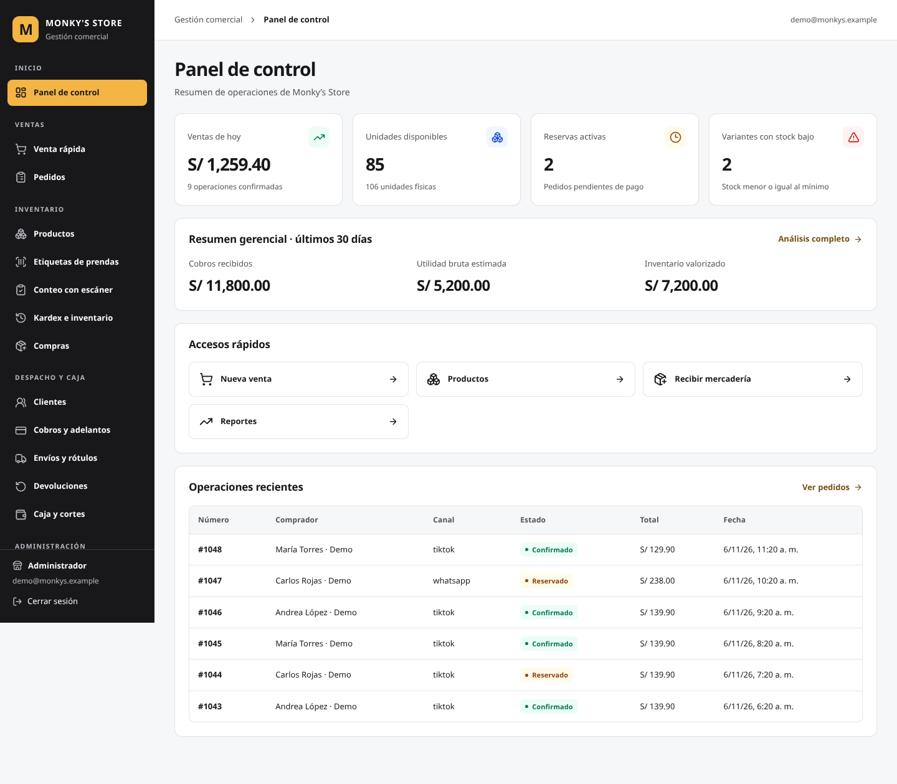
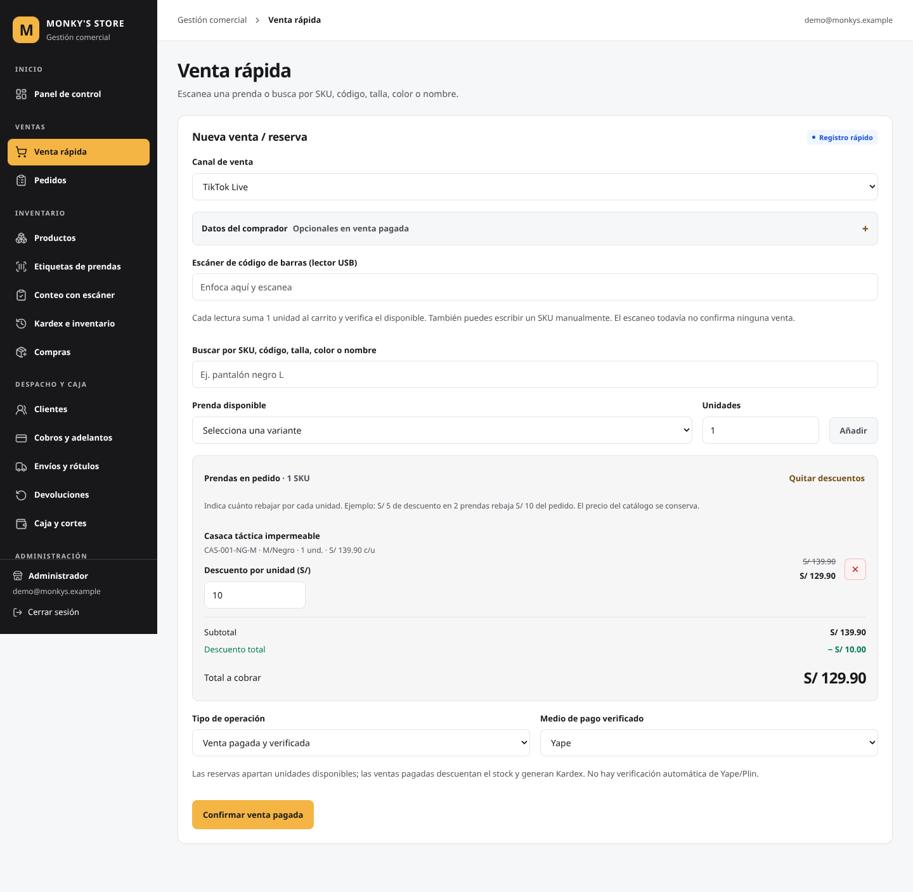

# Monky’s Store — paleta grafito + ámbar

## Resultado

Se aplicó la paleta solicitada a los componentes y módulos existentes del ERP, usando los tokens de `app/globals.css`. El proyecto mantiene Next.js, React, TypeScript y CSS global; no se añadieron dependencias ni se cambiaron cálculos, consultas, permisos, stock, descuentos o estados del negocio.

La estructura de las pantallas se conserva. En celulares de hasta 480 px, el tamaño de las cifras de las tarjetas se adapta para evitar que importes largos salgan del recuadro, conservando las columnas existentes. Se corrigió así el desbordamiento observado en Reportes a 320 px.

Esta actualización no requiere ejecutar SQL en Supabase.

## Tokens y jerarquía

| Uso | Color |
| --- | --- |
| Menú lateral | `#18181B` |
| Texto principal del menú | `#FAFAFA` |
| Texto secundario e iconos del menú | `#B8B8C1` |
| Marca, selección y acción principal | `#F4B544` con texto `#18181B` |
| Fondo general | `#F6F7F9` |
| Superficies y campos | `#FFFFFF` |
| Texto y cifras principales | `#18181B` |
| Texto secundario | `#52525B` |
| Bordes y separadores claros | `#E4E4E7` |
| Enlaces destacados | `#765014` |

| Estado | Texto o icono | Fondo |
| --- | --- | --- |
| Éxito | `#047857` | `#ECFDF5` |
| Información | `#1D4ED8` | `#EFF6FF` |
| Pendiente o advertencia | `#92400E` | `#FFFBEB` |
| Error | `#B91C1C` | `#FEF2F2` |

Los estados de hover, pulsación, selección, borde oscuro y deshabilitado se derivan de esos tokens con `color-mix`, sin introducir otra paleta de marca. Los nombres de los estados siguen acompañando al color.

Se unificaron botones, campos, tablas, pestañas, filtros, paginación, avisos, indicadores, gráficos existentes, carga y pantallas vacías. La opción activa del menú tiene texto e icono grafito; su foco también usa grafito para que siga visible sobre el ámbar. Los demás elementos del menú tienen foco ámbar sobre fondo oscuro.

Los avisos del formulario de acceso ahora distinguen visualmente un error de ingreso de una solicitud de cuenta completada. Solo cambia la presentación del resultado; la autenticación y la activación de cuentas siguen funcionando como antes.

## Archivos modificados

| Archivo | Cambio |
| --- | --- |
| `app/globals.css` | Paleta central, estados de interacción, colores semánticos y formatos de impresión. Se eliminaron los colores hexadecimales dispersos fuera de los tokens. |
| `components/print-labels.tsx` | Los estilos de rótulos pasan a la hoja global para estar disponibles antes de imprimir. Se conservan sus medidas. |
| `components/barcode-labels.tsx` | Atributo visual para identificar las filas que ya tienen etiquetas seleccionadas. No cambia las cantidades. |
| `components/inventory-count-manager.tsx` | Nombre accesible de cada campo de cantidad mediante su SKU. |
| `components/login-form.tsx` | Éxito y error con su color y anuncio accesible correspondientes. |
| `app/api/reportes/exportar/route.ts` | Cabecera Excel grafito con texto claro; columnas, datos y formatos existentes conservados. |

## Verificación

Las páginas reales se ejecutaron en copias temporales con datos ficticios y respuestas simuladas de Supabase. Esas sustituciones no se incluyen en el código entregado y no se crearon operaciones en la base de producción.

| Comprobación | Resultado |
| --- | --- |
| `npm run typecheck` | Correcto. |
| `npm run build` | Compilación de producción correcta, con variables de conexión ficticias. |
| `npm run test:regression` | 47 correctas y 0 fallidas. |
| Controles estáticos de fases 2, 3, 4A, 4B y despliegue | Correctos. |
| Recorrido visual y adaptación | 20 pantallas × 5 anchos: 100 comprobaciones, sin desbordamiento horizontal del documento. |
| Anchos | 1440, 1366, 834, 390 y 320 px. |
| Interacción | 17 comprobaciones correctas: foco, hover, pulsación, filtros, desplegables, venta y descuento, confirmación nativa, menú móvil, validación local, fallo de guardado, éxito, vacío, error de consulta, carga, movimiento reducido, colores semánticos y mensajes de acceso. |
| Accesibilidad automática | 24 auditorías con axe, etiquetas WCAG 2 A/AA y 2.1 AA: 0 infracciones detectadas. No equivale a una certificación. |
| Impresión | Rótulos de 150 mm de ancho máximo y 72 mm de alto mínimo; etiquetas de 50 × 30 y 40 × 25 mm. Medidas, tipografía y geometría de los códigos iguales a la versión anterior en la emulación de impresión. |
| Códigos de barras | Se conservan las barras negras, fondo blanco, número de barras y `viewBox` de la muestra. |
| Exportación Excel | Archivo generado y leído: cabecera `FF18181B`, texto `FFFAFAFA`, ocho filas de datos y cabecera conservadas en la muestra. |
| JavaScript durante el recorrido | Ningún error. |

Se revisaron Panel, Venta rápida, Pedidos, Productos, Etiquetas, Conteos, Inventario, Compras, Clientes, Cobros, Envíos, Devoluciones, Caja, los tres reportes, Equipo, Seguridad, Ingreso y Rótulos.

La comparación inicial detectó textos con contraste insuficiente en Etiquetas, Conteos, Reportes, Equipo y Seguridad. Con los nuevos tokens, las combinaciones verificadas superan 4,5:1. Algunos resultados: texto principal sobre blanco **17,72:1**, texto del botón sobre ámbar **9,74:1**, enlaces sobre blanco **7,17:1**. El menor contraste entre los cuatro pares semánticos verificados es **5,21:1**.

[Resultados detallados de las comprobaciones](docs/paleta/verificaciones.json).

## Capturas

Todas muestran datos ficticios de prueba.

[Envíos con estados separados](docs/paleta/envios.png) · [Panel en celular](docs/paleta/celular.png) · [Rótulos en emulación de impresión](docs/paleta/rotulos.png).

## Límites de la revisión

Las ventanas nativas de confirmación, impresión y algunos desplegables dependen del navegador y del sistema operativo. Se conservan sus funciones; no se reemplazaron por ventanas propias como parte de este cambio de paleta.

Se utilizó Chromium con tamaños de ventana y emulación de impresión. Quedan pendientes dispositivos físicos, Safari, lectores de pantalla reales, impresión física y el recorrido con la sesión real de Supabase. Las pruebas automatizadas y las capturas no verifican la configuración de la cuenta de producción.
